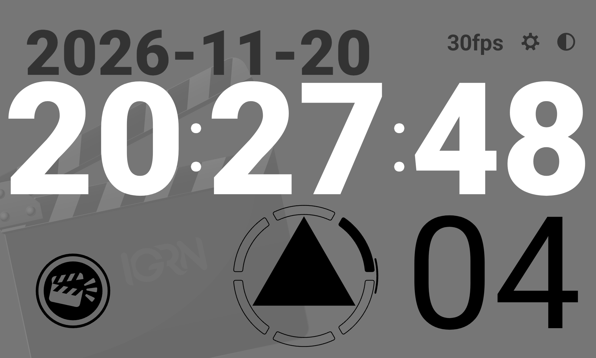
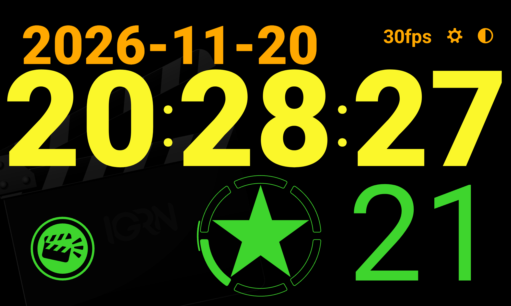
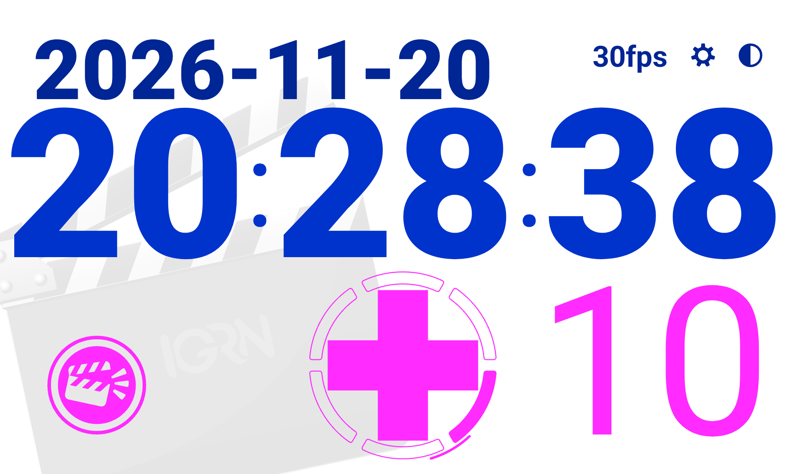
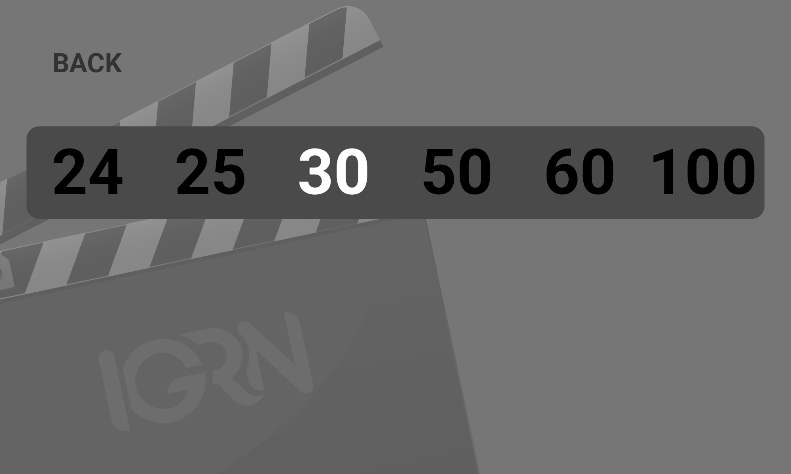
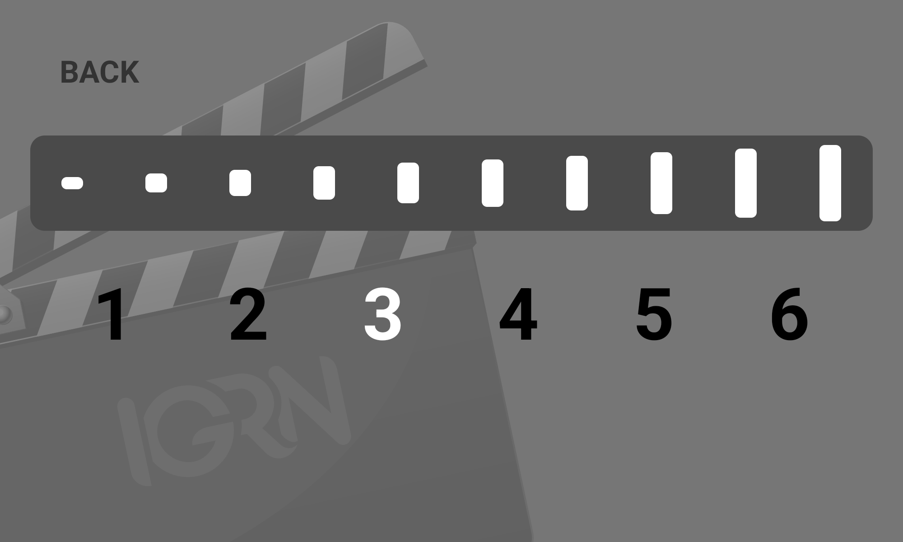

# TimeClock V2

TimeClock is a full-screen Android clock for camera work and post-production. It displays the current date and time, a selectable camera frame rate, and visual timing markers in a landscape layout.

## Features

- Large local date and HH:MM:SS clock.
- Selectable frame rates: 24, 25, 30, 50, 60, and 100 fps.
- Frame counter synchronized to real time; its rendered text size matches the clock, and it counts from 00 through FPS - 1 before resetting each second.
- Five Zener symbols, each shown for 11 display refreshes followed by one blank refresh.
- A six-position functional ring; its twelve SVG states show each functional position twice, while the smaller ring marks are decorative.
- VSync-based animation through Android Choreographer; Zener timing stays independent of the selected camera FPS.
- Three color schemes: neutral gray, dark, and light, with consistent colors across each screen zone.
- Main-screen Clack button: plays the selected sound and flashes the background red for 100 ms.
- Functions screen: ten-step volume slider (1 mutes; 10 is maximum app playback level) and six selectable signal sounds. Changing a signal or finishing a volume adjustment previews the sound once.
- Vector SVG clapperboards, Zener symbols, ring states, and controls.
- Full-screen landscape display that stays awake while the app is open.

## Screenshots

Place the five tablet screenshots in `screenshots/` using these filenames:

| Neutral gray | Dark | Light |
|---|---|---|
|  |  |  |

| FPS selector | Functions / signals |
|---|---|
|  |  |

## Build and test

Requirements: Android Studio's JDK (Java 17 or later) and the Android SDK configured for the project.

On Windows:

```powershell
.\gradlew.bat testDebugUnitTest assembleDebug
```

The debug APK is written to:

```
app/build/outputs/apk/debug/app-debug.apk
```

A GitHub Actions workflow builds and tests v2-development and publishes the debug APK as a workflow artifact.

## Project

- Android application module: app
- Language: Kotlin
- Minimum Android version: Android 8.0 (API 26)
- No runtime permissions are required.
