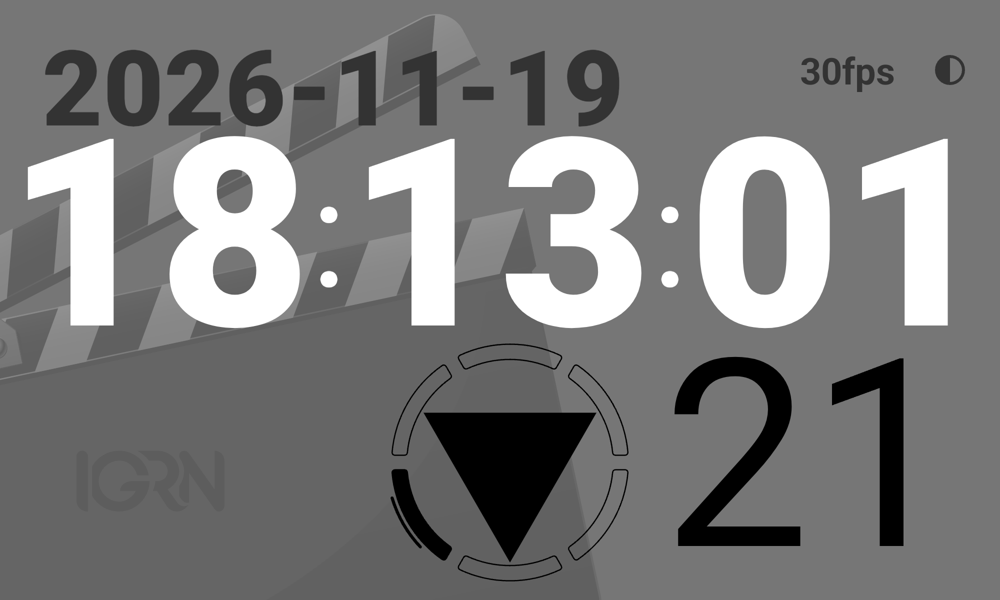
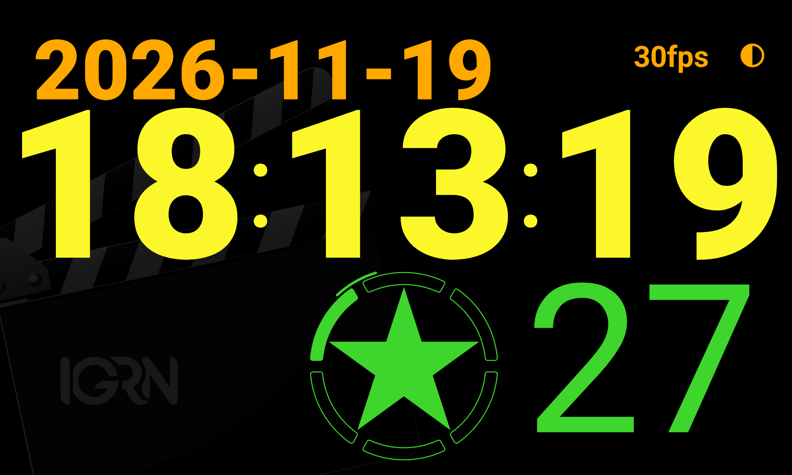
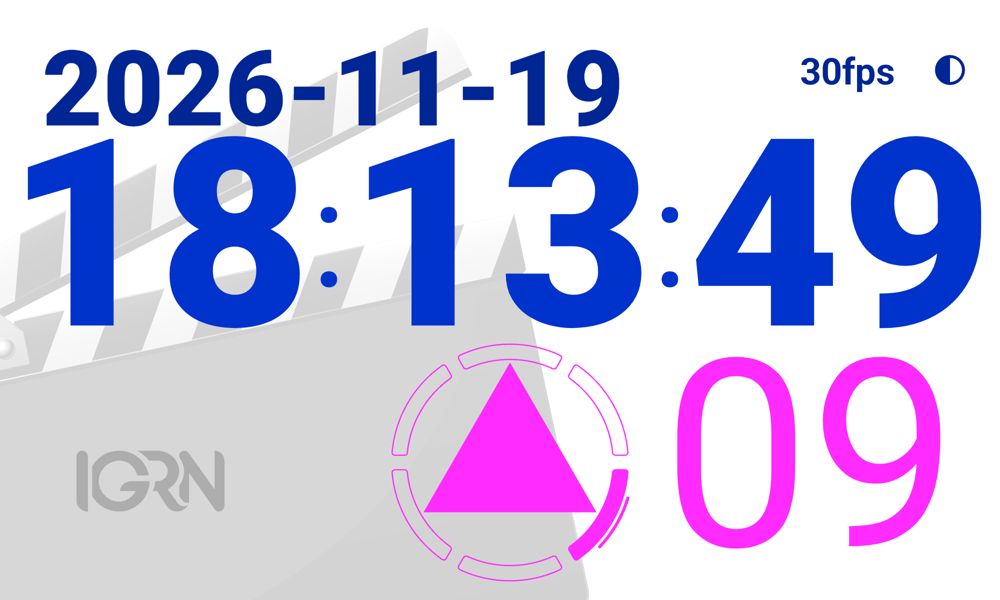
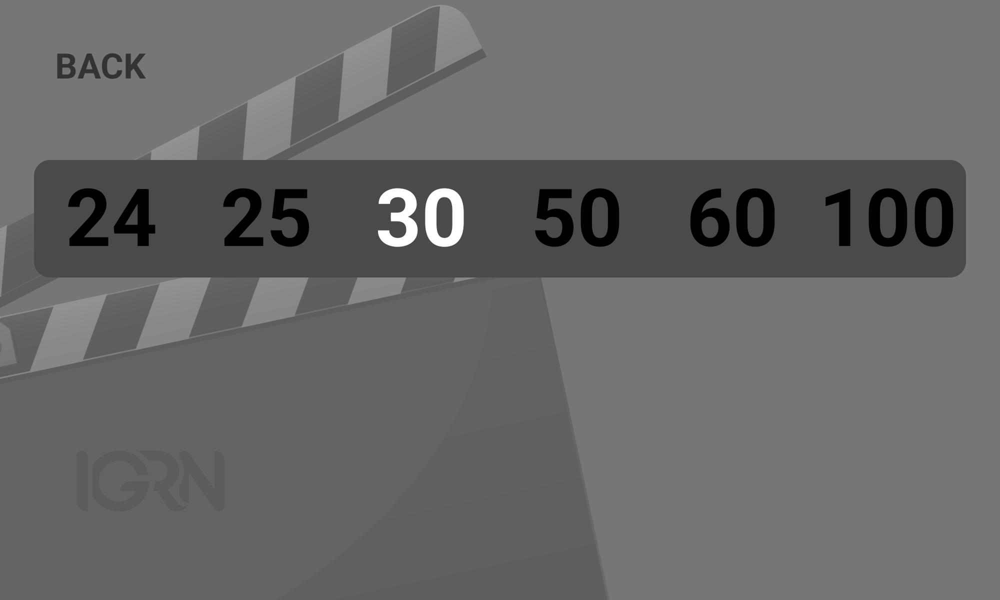

# TimeClock V2

TimeClock is a full-screen Android clock for camera work and post-production. It displays the current date and time, a selectable camera frame rate, and visual timing markers in a landscape layout.

## Features

- Large local date and HH:MM:SS clock.
- Selectable frame rates: 24, 25, 30, 50, 60, and 100 fps.
- Frame counter that runs from 00 through FPS - 1 and resets each second.
- Five Zener symbols, each shown for 11 display refreshes followed by one blank refresh.
- A 6-segment ring that advances continuously alongside the Zener symbols.
- VSync-based animation through Android Choreographer; Zener timing stays independent of the selected camera FPS.
- Three color schemes: neutral gray, dark, and light. Each applies consistent colors across the date/FPS controls, clock, and lower marker band.
- Vector SVG artwork for the logo, clapperboard, Zener symbols, ring segments, and theme control.
- Full-screen landscape display that stays awake while the app is open.

## Screenshots

The screenshots below show the three main color schemes and the FPS selector.

| Neutral gray | Dark |
|---|---|
|  |  |

| Light | FPS selector |
|---|---|
|  |  |

## Build and test

Requirements: Android Studio's JDK (Java 17 or later) and the Android SDK configured for the project.

On Windows:

```powershell
.\gradlew.bat testDebugUnitTest assembleDebug
```

The debug APK is written to:

```
app/build/outputs/apk/debug/app-debug.apk
```

A GitHub Actions workflow builds and tests v2-development and publishes the debug APK as a workflow artifact.

## Project

- Android application module: app
- Language: Kotlin
- Minimum Android version: Android 8.0 (API 26)
- No runtime permissions are required.
